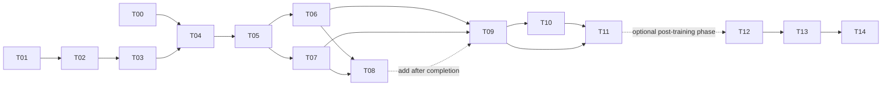

# Training and Tracking Task Plan

## Scope and status language

This is a fresh training project. Every result-bearing run starts from the same generic pretrained YOLO initialization or the appropriate official SAM2.1 base model. All optimizer state, threshold selection, and result artifacts are created under this protocol.

`Implemented` below means a reference component exists in this repository. `To implement` means the training team must build and validate the integration before it can be used. `Proposed` means an experiment or acceptance rule, not a completed result. T00–T11 form the model-training core. T12–T14 are a distinct, optional post-training video-tracking phase and must not be described as already integrated or evaluated.

Data, annotations, manifests containing private paths, raw videos, checkpoints, and credentials remain external and are not published. See [03_DATA.md](03_DATA.md) for the data contract and [08_TRACKING_INTEGRATION.md](08_TRACKING_INTEGRATION.md) for the follow-on tracking boundary.

## T00 — Build a clean, reproducible environment

**Owner:** training engineering. **Dependencies:** none. **Priority:** P0. **Status:** planned.

Create a clean Linux/CUDA/PyTorch environment with pinned Ultralytics and official SAM2 dependencies. Record the actual GPU, VRAM, CPU, storage, library versions, and repository commit. Initialize all YOLO arms from one identical generic pretrained model and all SAM arms from their stated official SAM2.1 base.

**Outputs:** `environment.json`, `requirements-lock.txt`, `runtime_config.yaml`, and `preflight.json`.

**Acceptance:** CUDA forward/backward passes; CPU decoding; one RGBD sample; one YOLO inference; one SAM2 inference; deterministic seed plumbing; and verified artifact writes. Throughput and memory claims must be measured on the actual hardware.

## T01 — Acquire and verify the required data

**Owner:** data. **Dependencies:** may run with T00. **Priority:** P0. **Status:** planned.

Resolve the external dataset inventory, including the two metadata tables, source video links, `annotation_archive`, and the DJI, ARD100, Anti-UAV, and NPS assets selected for this study. Verify each source video by byte size, SHA256, dimensions, frame count, and frame indexing. Preserve capture group, video ID, frame rate, source annotation, and provenance.

Use newly supplied material for training only where a valid positive box exists. An unreviewed empty annotation is unknown, not a negative. Retain a negative frame only when review evidence establishes that the frame is fully annotated and contains no target.

**Outputs:** external `asset_inventory.csv`, `assets.sha256`, `download_audit.json`, and `missing_assets.csv`.

**Acceptance:** every selected video decodes completely and all label coordinates pass overlay inspection. A transfer byte count is not proof of a complete asset. Raw assets remain outside this public package.

## T02 — Freeze splits and annotation reliability

**Owner:** data and independent evaluation. **Dependencies:** T01. **Priority:** P0. **Status:** planned.

Split by capture group and original video before creating frame triplets, crops, or clips. Neighboring frames and clips from the same flight must not cross train, validation, or test boundaries. Establish an in-domain validation/test split and target-domain manifests. Audit whether each evaluation frame is exhaustively annotated.

Every frame record must distinguish `has_positive_box`, `boxes_complete_for_frame`, `reviewed_negative`, and `annotation_quality`. Box-only data do not provide mask truth. They also do not automatically provide consistent object identities; MOT evaluation requires a separately reviewed identity layer.

Review and correct enough training frames to support background-candidate supervision and enough validation/test sequences to measure target absence and false positives. Explicitly annotate ambiguous empty records before including them as negatives. If this remediation is unavailable, the affected T08 background training and FP-constrained calibration are blocked; any evaluation on incomplete annotations remains provisional. Do not create missing absence labels by assuming that an unlabeled region is empty.

**Outputs:** external frozen `train.jsonl`, `val.jsonl`, `test_in_domain.jsonl`, target-domain manifests, `split_audit.json`, and `annotation_audit.json`.

**Acceptance:** zero overlap of original-video hashes or capture groups across splits; per-domain counts for videos, frames, objects, reviewed negatives, and size bins; and no substitution of training material for a missing held-out set. Evaluation on incompletely reviewed frames must be labeled provisional.

## T03 — Validate and freeze the motion-residual input

**Owner:** training engineering. **Dependencies:** T01 and T02. **Priority:** P0. **Status:** planned; numerical reference implementation exists.

Reproduce the background-motion compensation, local parallax correction, and adjacent-frame residual in [`reference_implementation/yolomg_parallax_robust_difference.py`](reference_implementation/yolomg_parallax_robust_difference.py), [`reference_implementation/data_stream.py`](reference_implementation/data_stream.py), and [`reference_implementation/motion_cache.py`](reference_implementation/motion_cache.py). For grayscale frames aligned to center frame `t`:

`D = (abs(I_t - aligned(I_(t-1))) + abs(I_t - aligned(I_(t+1)))) / 2`.

Use the intersection of valid warp regions, set invalid pixels to zero, and feed `clip(D / 255, 0, 1)`. Concatenate the center-frame color image to form `[R,G,B,D]`. Do not train from a colorized visualization or per-frame auto-stretched residual.

The reproduction starting parameters are local grid **36×21**, neighbors **18**, radius **190**, maximum shift **18**, local application threshold **0.18**, and tracking scale **0.5**. These values are starting points, not evidence of optimality. Texture suppression of the form `strength × (local_mean + 0.55 × local_std)` is a separate B-S ablation.

**Outputs:** `flow_config.json`, code/config hashes, cache index, 20–50 representative RGB/D/box overlays, and domain-level failure rates.

**Acceptance:** identical resize, letterbox, crop, and flip transforms for RGB, D, and boxes; invertible original-image coordinates; explicit D=0 fallback on motion failure; and retention of RGB for hovering or low-texture targets. The symmetric residual needs frame `t+1`, so it has one-frame lookahead and is not strictly causal online inference.

## T04 — Implement one unified training and evaluation entry point

**Owner:** training engineering. **Dependencies:** T00, T02, T03. **Priority:** P0. **Status:** partly implemented in reference code; unified adapter is to implement.

Drive A and B through the same data stream and configuration. Match read order, sampling, augmentation, effective batch, shared initialization, optimizer, schedule, stopping rule, P2 head, image scale, and detection objective. A receives RGB only; B receives RGB plus D and only the required input-stem difference.

Build a common evaluation-schema adapter that preserves sample ID, domain, sequence, source-validation identity, complete-negative status, original box, and coordinate transforms. Use the published components in [`reference_implementation/`](reference_implementation/) as inputs: `fusion_model.py`, `yolo11m_p2.yaml`, `augment_full.py`, `sampling.py`, `precision_policy.py`, `training_support.py`, and `metrics.py`. The unified fresh A/B trainer and formal evaluator remain to implement. A command-line flag counts as implemented only after code and tests establish that it exists and selects the intended model.

**Outputs:** unified entry point, smoke tests, `experiment_matrix.yaml`, frozen replay/sampling plan, run manifest, and evaluation adapter.

**Acceptance:** A and B observe the same sample-ID sequence; transformed validation records match sample by sample; a short run saves and reloads; and resume within that same new run restores step, RNG, and optimizer state.

## T05 — Run smoke tests and a new-run interruption drill

**Owner:** training engineering. **Dependencies:** T04. **Priority:** P0. **Status:** planned.

Run 20–100 optimization steps on a small, domain-balanced subset and render samples and predictions. Exercise the SAM teacher on 8–16 valid training examples and train the student for one epoch. Interrupt a newly created run and resume its own checkpoint to verify atomic writes and preemption robustness.

**Outputs:** `smoke_report.md`, before/after state, logs, timing, and peak memory.

**Acceptance:** non-NaN losses, increasing log steps, correct resume cursor, actual accelerator use, and no inference path that reads a ground-truth prompt. Smoke results establish pipeline operation only and are not research performance.

## T06 — Train the fair YOLO A/B comparison

**Owner:** training engineering. **Dependencies:** T05. **Priority:** P0. **Status:** planned.

Train A, RGB-only YOLO11m-P2, and B, input-fused RGBD YOLO11m-P2. Begin with seed **17**, then run preregistered seeds **23** and **41** if the declared compute budget permits. The initial image size is **1280**. A microbatch of **4** with accumulation **2** is only a starting configuration; any hardware-driven change must be applied to both arms.

Every full epoch must cover the selected training set and log replay separately. Select checkpoints using source validation under one frozen rule. Epoch count must follow the preregistered cap/early-stopping policy and validation curves.

**Outputs:** each arm's `last.pt`, `best_source.pt`, configuration, optimizer/RNG state, sample coverage, logs, and source-domain curves.

**Acceptance:** matched training budgets and decision rules. Do not extend only the arm that appears better. One seed supports only a preliminary statement; the formal multi-seed conclusion requires all three seeds under the same protocol.

## T07 — Train the prompt-conditioned SAM2 refiner

**Owner:** SAM2 and training engineering. **Dependencies:** T02 and T05. **Priority:** P0. **Status:** reference implementation exists; fresh reproduction required.

Use official SAM2.1 Hiera Large as a teacher. On training data only, provide human boxes as prompts and generate pseudo masks, then filter them by frozen quality and geometry rules. Train official SAM2.1 Tiny with only `sam_mask_decoder.*` parameters unfrozen; freeze the image encoder, prompt encoder, memory encoder, and memory attention. [`reference_implementation/sam_adapt.py`](reference_implementation/sam_adapt.py) is the component-level reference; the fresh orchestration and evaluation path still requires validation.

The target is the accepted teacher pseudo mask, never a filled ground-truth rectangle. Record weak/pseudo supervision and acceptance by domain, video, and target size. The resulting artifact is a **prompt-conditioned SAM2-Drone refiner**. Its pretrained video memory is not adapted by this procedure.

**Outputs:** external pseudo-mask manifest with teacher/version/quality/provenance, rejection reasons, decoder checkpoint, loss curves, and complete parameter list.

**Acceptance:** no validation/test pseudo labels; fixed automatic detector boxes at evaluation; and no ground-truth box prompts in deployment or primary evaluation. `GT box → SAM` is allowed only as a clearly labeled oracle-prompt diagnostic.

## T08 — Implement candidate classification and box refinement on SAM2 features

**Owner:** SAM2 research. **Dependencies:** T02, T06, T07. **Priority:** P1. **Status:** to implement.

Attach a drone/background classifier and box-regression head to SAM2 RGB features and candidate ROI/box embeddings. Start with a frozen image encoder; evaluate LoRA or adapters only as separately controlled experiments. The first candidate source is frozen YOLO B. An independent SAM detector claim requires a separately implemented and evaluated proposal/objectness module.

Use only fully annotated training frames for background candidates. Unknown candidates on incomplete frames are ignored. Generate training proposals by video-level cross-fitting, or disclose a separately partitioned proposal-training/head-training alternative. A proposed starting match is IoU ≥ **0.5** positive, IoU ≤ **0.3** negative, and intermediate IoU ignored. Candidate losses may combine BCE/Focal classification, L1/GIoU regression, and an optional mask auxiliary loss; weights must be selected on source validation.

**Outputs:** code, head/adapter weights, proposal manifest, match/ignore rules, threshold calibration, and inference API.

**Acceptance:** input is RGB/video plus automatic candidates only; output includes drone confidence, original-image `xyxy`, and optional mask. Compare against frozen SAM2 and decoder-only adaptation. Until this task passes, the deliverable remains a detector plus segmentation refiner, not a second independent detector.

## T09 — Lock models and run fair evaluation

**Owner:** independent evaluation. **Dependencies:** T06 and T07; add T08 only after completion. **Priority:** P0. **Status:** planned.

Evaluate A, B, B plus frozen SAM2 Tiny, B plus decoder-adapted SAM2 Tiny, and B plus the T08 head when available. Freeze proposals, NMS, transforms, fallback behavior, test manifests, and source-validation threshold selection before opening test results.

Report AP50, AP50–95, precision, recall, F1, FP/frame, target-size recall, and per-domain/per-video values. Preserve low-score predictions for AP. Report a fixed reference threshold and source-validation-selected operating points. Include proposal recall at frozen K values, paired video/capture-group bootstrap intervals with **2000** replicates, and per-seed results. Time decoding, motion residual, YOLO, SAM, and one-frame lookahead separately with batch size 1 p50/p95 latency and hardware details.

**Outputs:** raw prediction JSONL, full metric CSV, `threshold_selection.json`, bootstrap intervals, error cases, and runtime measurements.

**Acceptance:** identical ground truth and protocols across arms; no test-threshold retuning; and separate accounting for detector misses, SAM refinement failures, and candidate-classifier rejection errors. Box-only ground truth supports box metrics only, not true mask IoU, Dice, or J&F.

## T10 — Run controlled motion and SAM ablations

**Owner:** research and evaluation. **Dependencies:** T09. **Priority:** P1. **Status:** planned.

At minimum compare A vs B, B vs B+frozen SAM2, and frozen vs decoder-adapted SAM2 of the same Tiny architecture. To isolate motion compensation, compare B-G (global-only D) against B (global plus local D). Treat texture suppression as B-S. A pre-Detect fusion C is optional and requires its own matched training.

D=0 and shuffled-D tests are sensitivity diagnostics; they are not replacements for a separately trained RGB baseline. Do not attribute gains to fusion location when data quantity, model size, initialization, or compute also changes.

**Outputs:** ablation table, one-change audit, and failure attribution.

**Acceptance:** every claimed causal factor has a matched control and uncertainty is reported at the video/capture-group level.

## T11 — Deliver models and a reproducible report

**Owner:** training and evaluation. **Dependencies:** T09 and applicable T10 arms. **Priority:** P0. **Status:** planned.

Deliver the new YOLO models, SAM components and optional detection head, official base dependency references, configurations, split hashes, environment lock, inference commands, complete results, and failure cases. Use [06_RESULT_TEMPLATE.md](06_RESULT_TEMPLATE.md) to answer whether recall improves on in-domain and each target domain, whether false positives fall, whether uncertainty supports the difference, and whether compute/latency costs are acceptable.

**Acceptance:** an independent person reproduces inference on one video and the complete offline metric suite from a clean environment. Model names distinguish official base, decoder-adapted refiner, and candidate-classification variants. Negative results and missing arms remain visible.

## T12 — Integrate the frozen detector/refiner into video tracking

**Owner:** tracking engineering. **Dependencies:** T11 delivered and locked detector artifacts. **Priority:** P1 follow-on. **Status:** to implement; does not block T11.

Implement the adapter described in [08_TRACKING_INTEGRATION.md](08_TRACKING_INTEGRATION.md): RGB+D YOLO11m-P2 outputs become `DetectionCandidate` records in original coordinates, then enter the existing `ConstantVelocityTracker`. Retain RGB and detector-box fallback. Add optional SAM2 video-memory propagation and Action Bank evaluation only behind explicit configuration and frozen detector checkpoints.

**Outputs:** adapter, integration tests, video inference manifest, per-stage audit JSONL, and latency accounting.

**Acceptance:** no ground-truth prompt or identity at inference; coordinate/score/source fields survive the adapter; t+1 latency is explicit; and detector-only fallback produces valid output when D or SAM fails.

## T13 — Add loss, reacquisition, and memory safety controls

**Owner:** tracking research. **Dependencies:** T12. **Priority:** P1 follow-on. **Status:** proposed/to implement.

Define explicit states for tentative, confirmed, lost, and reacquiring tracks. Freeze gates for missed-frame budget, innovation/distance, scale change, detector confidence, memory confidence, and reset behavior using sequence-level validation only. Prevent stale or low-confidence SAM2 memory from recursively writing predictions back into memory. Require detector-supported confirmation after loss and log every memory write, suppression, reset, and fallback.

**Outputs:** state-machine specification, configuration, event audit, unit/integration tests, and safety ablations.

**Acceptance:** deterministic reset at video boundaries; no identity carried between videos; no unbounded memory-only drift; and explicit performance of detector-only, tracker-only propagation, tracker+memory, and tracker+memory+Action-Bank arms.

## T14 — Run sequential tracking evaluation

**Owner:** independent tracking evaluation. **Dependencies:** T12 and T13. **Priority:** P1 follow-on. **Status:** proposed.

Evaluate complete videos in temporal order. Detection metrics alone remain required, but tracking claims require reviewed frame coverage and consistent ground-truth identities. Where identity labels are absent, report only sequence detection/continuity diagnostics such as recall over annotated frames, fragmentation proxies, time-to-reacquire, false-track duration, and latency; do not report MOTA, IDF1, HOTA, or identity switches as ground truth.

When consistent IDs are available, report a preregistered MOT suite, sequence-level confidence intervals, loss/reacquisition slices, and complete failure videos. Compare frozen detector-only, `ConstantVelocityTracker`, optional SAM2 memory, and Action Bank with one component changed at a time.

**Outputs:** sequential predictions, reviewed identity manifest when available, metric tables, bootstrap intervals, latency/resource report, and failure taxonomy.

**Acceptance:** videos/capture groups are the statistical units; thresholds are frozen from validation; t+1 lookahead is included; and no tracking benefit is attributed to model training without the matching detector-only baseline.

## Dependency graph

T08 is optional for the first T06/T07 report, but it is mandatory before claiming a SAM-feature candidate detector. T12–T14 are deliberately downstream: they must not alter the frozen training comparison or be presented as completed work.
