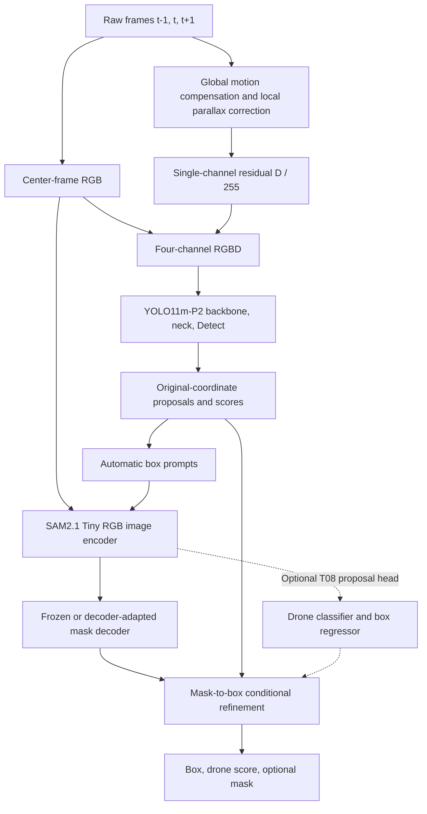

# Architecture, Supervision, and Experiment Protocol

## 1. Model-training core

Only YOLO consumes RGBD. SAM2 consumes center-frame RGB so the primary comparison does not change two modalities at once. SAM2 mask-quality or predicted-IoU output estimates segmentation quality; it is not a drone-class probability. Any use in ranking must have a source-validation-calibrated formula. The optional T08 classifier supplies explicit drone/background supervision; its implementation is available in `drone_training/sam_head.py`, and its proposal protocol and scientific evaluation remain to be executed.

The motion channel is a compensated brightness residual, not a dense optical-flow-vector tensor. Let the two neighboring grayscale frames be warped to `t`. Then

`D = (abs(I_t - aligned(I_(t-1))) + abs(I_t - aligned(I_(t+1)))) / 2`.

Use the common valid warp area, set invalid pixels to zero, and feed `clip(D/255, 0, 1)`. Preserve center-frame color independently. On compensation failure, set D to zero and log the event; never delete a proposal solely because motion is weak. This preserves an appearance path for hovering, distant, or low-texture drones.

Reproduction parameters are grid **36×21**, neighbors **18**, radius **190**, maximum shift **18**, local threshold **0.18**, and tracking scale **0.5**. They are experimental starting values. The presentation-style texture term `strength × (local_mean + 0.55 × local_std)` is not part of baseline B and belongs in B-S.

The symmetric formulation uses `t+1`. All latency reports must include the one-frame lookahead. A strictly causal `t-1,t` variant would require separate training and evaluation.

## 2. Implemented-reference versus planned boundary

| Component | Repository evidence | Fresh-project use |
|---|---|---|
| YOLO RGB/RGBD and P2 variants | [`reference_implementation/fusion_model.py`](reference_implementation/fusion_model.py) and [`reference_implementation/yolo11m_p2.yaml`](reference_implementation/yolo11m_p2.yaml) | Build one unified, tested entry point; start all fair arms from the same generic pretrained initialization |
| Motion residual | [`reference_implementation/yolomg_parallax_robust_difference.py`](reference_implementation/yolomg_parallax_robust_difference.py), [`reference_implementation/data_stream.py`](reference_implementation/data_stream.py), and [`reference_implementation/motion_cache.py`](reference_implementation/motion_cache.py) | Freeze code, parameters, transforms, hashes, and failure accounting in T03 |
| Training support | [`reference_implementation/augment_full.py`](reference_implementation/augment_full.py), [`reference_implementation/sampling.py`](reference_implementation/sampling.py), [`reference_implementation/precision_policy.py`](reference_implementation/precision_policy.py), and [`reference_implementation/training_support.py`](reference_implementation/training_support.py) | Compose and test the fresh unified trainer; no complete trainer is published as implemented |
| Metric component | [`reference_implementation/metrics.py`](reference_implementation/metrics.py) | Build the formal schema adapter and evaluator required by T04/T09 |
| SAM2 teacher/student adaptation | [`reference_implementation/sam_adapt.py`](reference_implementation/sam_adapt.py) | Reproduce from official SAM2.1 bases; train only `sam_mask_decoder.*` |
| SAM2 drone classifier/box regressor | Mask decoder is not a semantic detection head | Implement and independently validate in T08 |
| `DetectionCandidate` and `ConstantVelocityTracker` | Existing repository interfaces | Reference implementation only; no RGBD YOLO→candidate→tracker end-to-end adapter currently exists |
| SAM2 video memory | Present in official pretrained architecture; not trained by decoder adaptation | Optional T12/T13 follow-on; do not claim domain-adapted memory |
| Action Bank | Existing detector-agnostic post-processing concept/code | Optional frozen-detector tracking ablation, outside T00–T11 |

Repository-relative code references are implementation aids, not proof of an integrated product: [`../../qstr_dronedet/types.py`](../../qstr_dronedet/types.py), [`../../qstr_dronedet/tracking/kalman.py`](../../qstr_dronedet/tracking/kalman.py), and [`../../qstr_dronedet/tracking/`](../../qstr_dronedet/tracking/). The pending integration contract is in [08_TRACKING_INTEGRATION.md](08_TRACKING_INTEGRATION.md).

## 3. Supervision available from box-only annotations

### 3.1 YOLO

YOLO uses human box detection losses. A frame containing one positive box is not necessarily exhaustively annotated. Each record must carry `boxes_complete_for_frame` and annotation-quality fields. New unreviewed empty frames are excluded rather than treated as negatives.

### 3.2 Decoder-only SAM2 adaptation

The training path is:

`train RGB + train human box prompt → frozen official SAM2.1 Large teacher → filtered pseudo mask → official SAM2.1 Tiny mask-decoder training`.

The box is a prompt; filling its rectangle does not create a mask label. Pseudo masks remain weak supervision. Report candidate count, accepted count, and each rejection reason by domain, video, and size. Review whether filtering disproportionately removes tiny targets. A sample cap is a compute setting, not proof of full-data training.

At primary validation and deployment, only automatic detector boxes may prompt SAM. Ground-truth prompts are forbidden. `GT box → SAM` may appear only as an oracle-prompt diagnostic, clearly separated from automatic detection results. Because only the mask decoder is trained, the pretrained memory encoder and memory attention are not domain-adapted.

### 3.3 Candidate classification and box regression

T08 proposes ROI/box features from the SAM2 RGB representation followed by a binary drone/background head and a box-regression head. Start with a frozen image encoder. Candidate objectives may use BCE/Focal classification plus L1/GIoU regression, with mask loss as an optional auxiliary. Loss weights, ROI scale, and adapter/LoRA use are source-validation hyperparameters.

A preregisterable starting match is IoU ≥ **0.5** positive, IoU < **0.3** negative, and intermediate IoU ignored. Only exhaustive training frames or reviewed negatives may supply background labels. On partial frames, unmatched proposals are unknown and must be ignored.

Generate training proposals with video-level K-fold cross-fitting so the proposal model did not train on the current fold's video. All fold models share the same base initialization. A disjoint proposal-training/head-training split is acceptable when disclosed, but it reduces data efficiency. Without an independently trained proposal/objectness module, this head does not make SAM2 a standalone detector.

### 3.4 Annotation limits for tracking

Boxes without consistent object IDs support frame-level detection evaluation and some continuity diagnostics. They do not support identity-switch, IDF1, HOTA, or MOTA claims. T14 must first audit reviewed frame coverage and add consistent per-object identities across each evaluated sequence. Unreviewed absences cannot score false tracks, and sparse boxes cannot be silently interpolated into identity truth.

## 4. Preregistered model experiment matrix

| ID | System | Matched-control requirement | Question |
|---|---|---|---|
| A | RGB-only YOLO11m-P2 | Same data, generic initialization, seeds, sampling, augmentation, schedule, P2 head, scale, and budget as B | Appearance baseline |
| B | RGB + compensated D at input | Change only D and required stem weights | Does D improve detection? |
| B-FS | B + frozen official SAM2.1 Tiny | Freeze B proposals/ranking inputs and post-processing | Does generic mask refinement help? |
| B-AS | B + decoder-adapted SAM2.1 Tiny | Same Tiny base, proposals, and post-processing as B-FS | Does decoder adaptation add value? |
| B-DH | B + SAM2 candidate classifier/regressor | T08 complete; report extra training and inference cost | Does box supervision improve discrimination/localization? |
| B-G | RGB + global-compensation-only D | Retrain with the same budget as B | What does local parallax correction add? |
| B-S | B + separately fixed texture suppression | One additional transformation only | Does suppression help or erase tiny targets? |
| C (optional) | D fused immediately before Detect | Same P2 model, pool, initialization, and budget | Does fusion location matter? |

A/B is the minimum valid comparison. B-AS must be compared against B-FS using the same Tiny architecture; teacher size cannot be confounded with adaptation. B-DH adds supervision and compute, so report it as a system-benefit comparison rather than equal-compute proof.

All arms begin from the same declared generic YOLO initialization or their declared official SAM2.1 base. Checkpoint resume is used only for interruption recovery inside a run created under this protocol.

## 5. Dataset regimes

### Multi-source in-distribution study

Train on the frozen combination of selected source domains; choose validation and test videos from distinct capture groups. Evaluate all arms on identical manifests. This study asks whether the proposed components help after expanding the training pool.

### Strict target-domain study

For each target domain, exclude that domain from training, checkpoint selection, pseudo-mask generation, head training, calibration, and hyperparameter selection. Keep source domains identical across arms and start again from the common generic/official bases. Any domain used during development is not a pristine final confirmation set; reserve a new capture group or independent dataset for that role.

Infrared material is a separate modality/domain. State the single-channel-to-RGB conversion and do not merge it into a natural-RGB aggregate without a separate breakdown.

## 6. Detection metrics, thresholds, and uncertainty

Use original-coordinate boxes, confidence ranking, one-to-one matching, and IoU ≥ **0.5** for operating-point precision/recall. Duplicate predictions are false positives and unmatched ground truth is false negative. Report precision, recall, F1, FP/frame, AP50, and AP50–95 at IoUs 0.50:0.05:0.95. Preserve sufficiently low-score predictions before AP computation.

Report both a single frozen reference threshold and each system's source-validation-selected threshold under a preregistered objective, such as maximum recall at **0.1 FP/frame**. If validation negatives are not exhaustively reviewed, that objective cannot be calibrated reliably. Never tune a threshold on test. Report proposal recall at frozen K values such as 10/50/100, chosen before test.

Define project-specific target-size bins from original boxes using `sqrt(width × height)`: `[0,8)`, `[8,16)`, `[16,32)`, and `[32,∞)` pixels. Give counts and conditional recall for each; these are not COCO's official small-object categories. Also provide relative-area bins across resolutions.

Bootstrap paired differences by original video or capture group, with **2000** replicates and 95% intervals. Neighboring frames are not independent observations. For seeds 17, 23, and 41, show each result plus mean and standard deviation. A single seed is preliminary.

Measure batch-1 latency for decoding, motion processing, YOLO, SAM, and post-processing, with p50/p95, peak memory, hardware, and total accelerator hours. Include the `t+1` wait.

## 7. Post-training sequential experiment matrix

After T11 freezes the detector/refiner, T12–T14 may compare:

| ID | Frozen detector | Temporal component | Purpose |
|---|---|---|---|
| V0 | B or selected locked arm | None | Per-frame video baseline |
| V1 | Same checkpoint/proposals | `ConstantVelocityTracker` | Geometric continuity |
| V2 | Same as V1 | Optional official SAM2 video memory | Propagation benefit and drift risk |
| V3 | Same as V2 | Action Bank | Detector-agnostic decision layer |

Change one temporal component at a time. The adapter, memory controls, and sequential evaluation are planned work, not existing evidence. Preserve RGB and the original detector box as fallback whenever D, mask refinement, propagation, or memory fails.

## 8. Completion and claim rules

Engineering completion means automatic inference loads, runs without ground-truth prompts, resumes only its own new-run checkpoints, and emits hashed artifacts. Scientific completion means every preregistered arm and domain is reported, including zero, degraded, failed, or over-budget arms.

An improvement claim requires a matched comparison, uncertainty, per-domain tradeoffs, and cost. Higher recall with uncontrolled FP/frame is not comprehensive improvement. With box-only ground truth, SAM-derived boxes can be scored as detections, but true mask IoU, Dice, and J&F require an independent human-mask set.
