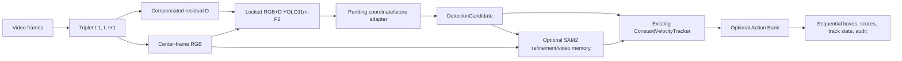

# Optional Post-Training Video Tracking Integration

## Status and boundary

This document specifies T12–T14, an optional phase after the T00–T11 model-training core. It is an implementation and evaluation plan. The repository contains `DetectionCandidate`, `ConstantVelocityTracker`, SAM2-related components, and Action Bank code, but it does **not** currently contain a validated end-to-end adapter from the newly trained RGB+D YOLO11m-P2 through those components. No tracking result is claimed here.

Reference interfaces are available at [`../../qstr_dronedet/types.py`](../../qstr_dronedet/types.py), [`../../qstr_dronedet/tracking/kalman.py`](../../qstr_dronedet/tracking/kalman.py), and [`../../qstr_dronedet/tracking/`](../../qstr_dronedet/tracking/). The detector-output adapter and its integration remain pending.

## Proposed pipeline

The detector consumes `[R,G,B,D]`; SAM2 continues to consume RGB. The symmetric D calculation needs `t+1`, so output for frame `t` has at least one-frame lookahead. This must appear in latency and online/causal claims.

## Required adapter contract

For every YOLO proposal, the adapter must create a `DetectionCandidate` in original-frame coordinates and preserve:

- `bbox_xyxy` after inverse letterbox/resize;
- detector confidence and class ID;
- source name and model/checkpoint hash;
- frame, video, and timestamp identifiers;
- transform provenance and D-failure flag;
- optional SAM mask/refined box and quality fields without overwriting the raw detector box.

The adapter must define score semantics explicitly. A SAM mask-quality estimate cannot be substituted for drone probability. If T08 is available, retain detector score and T08 classification score separately before any source-validation-calibrated fusion.

## Fallback policy

RGB is always retained. When motion compensation fails, use D=0 and continue through YOLO. When SAM fails, returns an empty/implausible mask, or violates a frozen refinement gate, preserve the original detector box and score. When temporal state is untrusted, emit the per-frame detector result rather than a memory-only hallucination. Log each fallback reason.

Ground-truth boxes, masks, and identities are forbidden as prompts or state inputs during deployment and primary evaluation. Oracle prompts may be used only in a separate diagnostic.

## SAM2 video memory

The T07 adaptation trains only `sam_mask_decoder.*`. The official pretrained memory encoder and memory attention are frozen and are not adapted to this drone domain. Optional video-memory use is therefore a post-training inference experiment, not a claimed property of the trained refiner.

Memory writes require frozen confidence and geometry gates. Every write must retain its initiating detector proposal, score, frame, and provenance. T13 must add loss/reacquisition controls that prevent low-confidence propagated masks from recursively becoming trusted memory. Reset all memory at video boundaries.

## Constant-velocity tracking and reacquisition

The existing `ConstantVelocityTracker` is the initial geometric baseline. T13 must formalize tentative, confirmed, lost, and reacquiring states and validate:

- maximum missed-frame budget;
- innovation/distance and scale-change gates;
- detector-supported confirmation after loss;
- memory suppression/reset after uncertain propagation;
- detector-box fallback and full state reset at sequence boundaries.

Thresholds must be selected on sequential validation videos and frozen before test. Do not tune them on sparse test annotations or individual failure clips.

## Action Bank

Action Bank is an optional detector-agnostic decision layer after the frozen detector/tracker interface. Evaluate it only after V0 detector-only and V1 constant-velocity baselines are established. Its result cannot be attributed to RGBD model training. Keep its configuration, compute, candidate inputs, and acceptance decisions in the per-frame audit.

## Annotation requirements

Box-only annotations have two distinct limitations:

1. An absent box is a usable negative only when the frame was reviewed as exhaustive.
2. Boxes do not define track identity unless the same object has a reviewed, consistent ID across the sequence.

Without exhaustive reviewed absence, false-track duration and FP/frame are provisional. Without consistent IDs, do not report MOTA, IDF1, HOTA, or identity switches. T14 may still report clearly scoped detection and continuity diagnostics on annotated frames, including time-to-reacquire where loss/reappearance is reviewable, fragmentation proxies, and latency.

## Fair sequential evaluation

Freeze the detector checkpoint, candidate set, NMS, and per-frame transforms. Compare V0 detector-only, V1 plus constant-velocity tracker, V2 plus optional SAM2 memory, and V3 plus Action Bank by adding one temporal component at a time. Use complete videos in temporal order and treat video/capture group as the statistical unit.

Report per-sequence detection metrics, continuity/reacquisition slices, false-track duration where negatives are reviewed, p50/p95 stage latency, peak memory, and failures. Include the `t+1` wait and separate decoding, residual, YOLO, SAM, tracker, and Action Bank costs. A tracking gain must be compared against the identical frozen detector-only output.

## Deliverables

T12 delivers the adapter, integration tests, configuration, sequential prediction schema, and event audit. T13 delivers the state machine, memory safety controls, and controlled ablations. T14 delivers sequential predictions, the annotation/identity audit, metrics with video-level uncertainty, and failure cases.

Raw videos, raw annotations, private manifests, checkpoints, and credentials remain external. Only documentation, schemas, configuration templates, and publishable code should enter this package.
